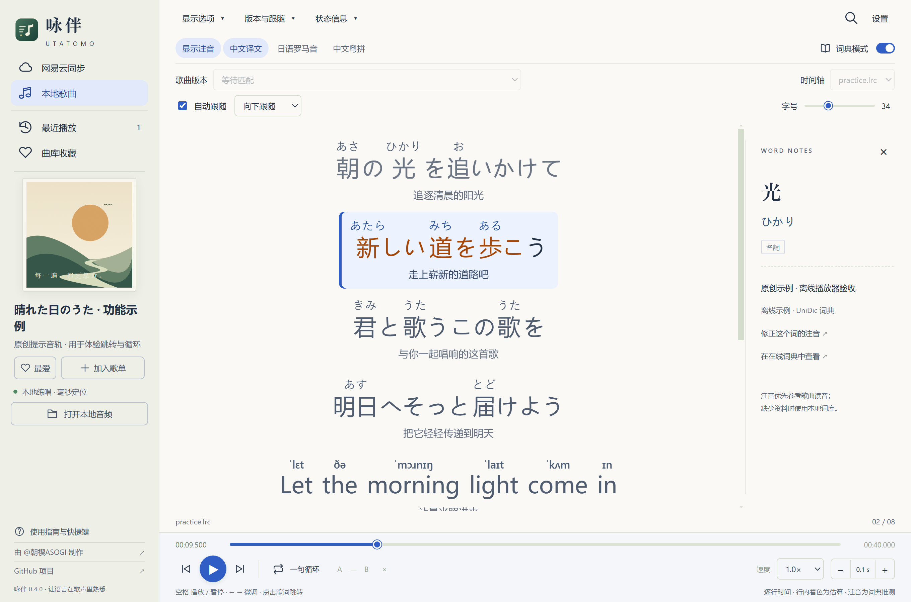
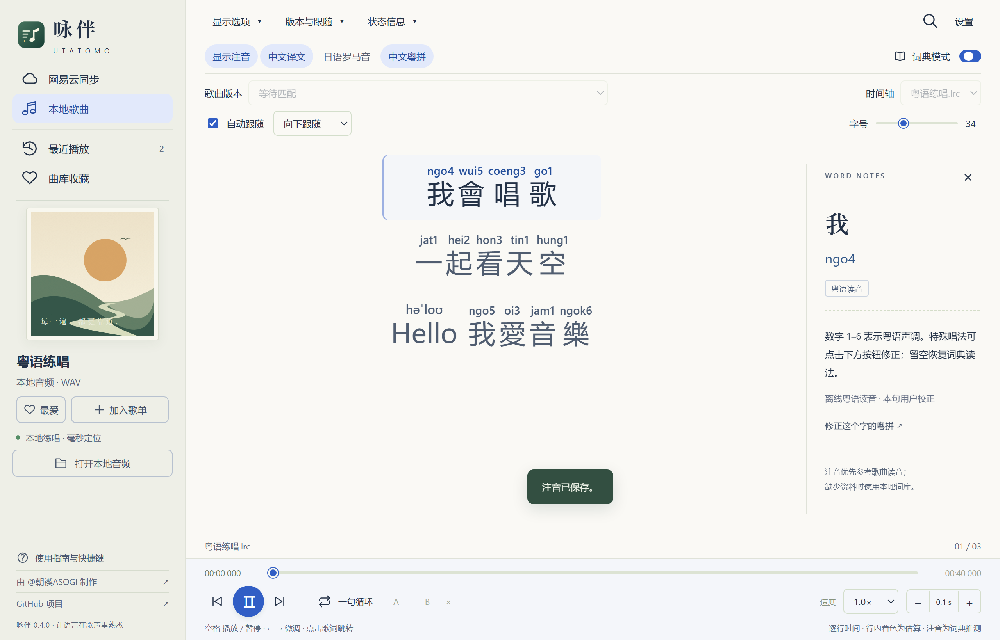
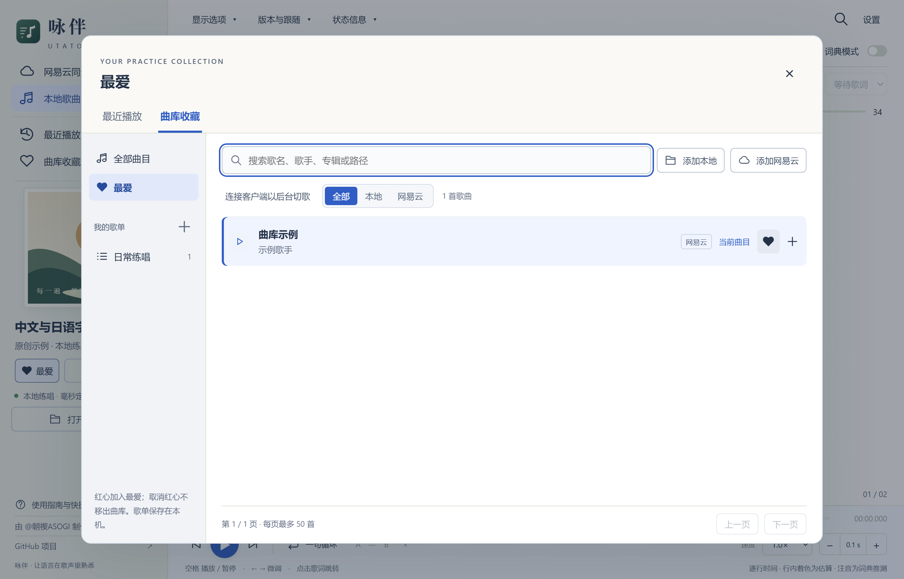
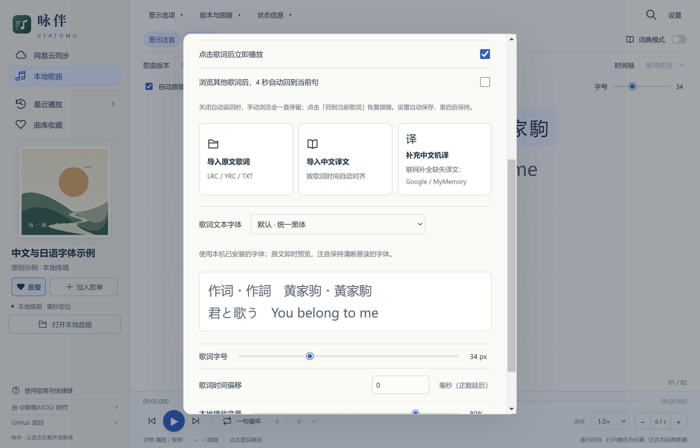

# 咏伴 · Utatomo

Windows 歌词跟唱工具。跟随网易云音乐，或打开本地音频练唱；支持日语假名 / 罗马音、英语音标，以及可选的中文粤语注音。最近播放、曲库收藏和本地歌单，让常练的歌随手可达。


受不了网易云音乐自带的歌词功能而诞生的产物，主要是为了方便自己跟唱、学新曲子什么的，虽然本地音频也支持，但是因为网易云用得比较多，所以做了联动功能，方便直接从网易云歌单里即开即用。

不保证注音百分百准确，但大部分是能识别出来的，识别不出的或者识别错误的部分支持手动修正。

工具连接网易云客户端后，在网易云里切歌，会自动同步到工具，工具里的播放也会和网易云同步。


作者：[朝禊ASOGI](https://space.bilibili.com/315312) · [GitHub 项目与反馈](https://github.com/AsaMisogi/Cloudmusic-Lyrics-Singing)

注：该项目由AI辅助完成。


B站演示视频：

https://www.bilibili.com/video/BV1ZfHf6pEik/


## 下载与启动

【百度盘】

链接: https://pan.baidu.com/s/1ZKFEDhp-ZP8Tc7GGMzRvMg?pwd=kzx8 

提取码: kzx8 


1. 在 [Releases](https://github.com/AsaMisogi/Cloudmusic-Lyrics-Singing/releases/latest) 下载 `Utatomo-0.4.0-windows-x64.zip`。
2. 完整解压到有写入权限的文件夹，例如 `D:\Utatomo`。不要在压缩包内直接运行。
3. 双击 `Utatomo.exe`。便携版包含 Python、Qt 与离线注音词典，无需另行安装 Python。

适用于 Windows 10 / 11 x64，窗口最小尺寸为 960 × 700。启动时会同时打开日志窗口和歌词窗口；关闭歌词窗口会退出程序。`_internal` 是程序依赖目录，请保留完整文件夹。

想先了解操作，可以点击空白页的「体验示例」。示例由原创日英句子和提示音轨组成，不是真人演唱。

首次启动会弹出「先确认网易云音乐路径」，自动预填识别到的安装目录。确认该目录包含 `cloudmusic.exe`，点击「保存路径」；识别不正确时可点「浏览…」重新选择，也可粘贴主程序的完整路径。暂时跳过仍能使用本地练唱，未保存时下次启动会继续提醒。日后可在「设置 → 网易云音乐路径 → 更改路径」随时修改。

## 功能

- 识别网易云当前歌曲，获取原文和中文译文；支持搜索歌名、歌曲 ID 或链接，以及切换歌词版本。
- 日语假名 / 罗马音、英语美式 IPA 注音；可以针对当前歌曲中某个词的位置修正读音。
- 中文原文可开启离线粤拼，支持简繁体、声调数字和本句修正，默认关闭。
- 本地 / 网易云最近播放：搜索、来源筛选、直接切歌，两种来源各保留最近 500 首。
- 曲库收藏和本地歌单：批量添加本地音频，搜索或粘贴网易云歌曲链接，支持混合来源、重命名和移除。
- 点击歌词跳转播放，单句循环、A/B 循环、歌词偏移和进度微调。
- 本地音频支持 0.5–1.5 倍速；客户端同步模式支持播放、暂停和双向进度控制。
- 点击词汇查询日汉或英汉释义；缺少中文译文时可手动补充机译。
- 调整字号、隐藏注音或译文、切换歌词跟随方式，自动保存显示偏好。
- 自动识别并保存网易云安装路径；连接时可确认重启正在运行的客户端。


## 界面示例

以下为程序实际运行截图，使用原创示例音轨与文本。

日语注音、中文译文与查词：



英语音标与紧凑窗口：


中文粤拼（原创示例）与「最爱」分类（离线示例元数据）：





## 跟随网易云音乐

普通启动后，程序会通过 Windows 媒体接口识别网易云当前歌曲。要使用双向进度控制：

1. 首次启动时确认安装路径；之后也可以在「设置」里修改。
2. 在咏伴点击「连接客户端」。如果网易云已运行，弹窗会询问是否重启；点击「重启并连接」后，工具会关闭网易云并按直连模式重新启动。点击「取消」或按 Esc 保留当前客户端和播放。
3. 在网易云播放歌曲，等状态显示「客户端直连 · 双向同步」。
4. 使用播放按钮、进度条、点击歌词或循环功能练唱。

声音由网易云客户端播放。切换歌词版本不会更换音频，VIP 和网盘曲目的播放仍取决于客户端自身权限。此模式暂不支持变速，循环最短为 0.8 秒；进度精度受客户端回传限制，可能有数百毫秒误差。

重启会中断当前播放。工具先请求关闭并等待退出；若网易云仅缩到托盘或未响应，会结束同一安装目录下的 `cloudmusic.exe` 后再启动。若已经直连，点击连接只提示当前状态，不重复重启。连接过程中按钮暂时禁用；若 30 秒内没有收到播放信息，会提示播放歌曲或检查路径、版本和端口，同时继续自动尝试连接。

路径不存在、权限不足，或正在运行的网易云与设置路径不同，都会显示明确提示；请修改路径或手动完整退出后重试。更改路径不会立即重启客户端，下次连接时使用新目录。

已在网易云 Windows 版 3.1.41.205529 验证客户端直连。其他版本可能因接口变化而无法连接，此时会退回 Windows 媒体接口，部分进度控制不可用。连接使用本机 `127.0.0.1:9222` 调试端口，不修改网易云安装文件；完整退出网易云后端口关闭，恢复普通启动方式即可停止使用直连。

## 打开本地歌曲

点击「打开本地音频」，选择 MP3、FLAC、WAV、M4A、OGG、OPUS、AAC 或 WMA。格式是否能播放取决于 Qt 解码器，失败时会显示错误。

同目录下的同名歌词会自动加载，例如：

```text
我的歌曲.flac
我的歌曲.lrc
我的歌曲.zh.lrc
```

原文支持 `.yrc`、`.lrc`、`.txt`，译文也支持 `.trans.lrc`。可在右上角「设置」手动导入歌词和译文，支持 UTF-8、UTF-16 和 GB18030 编码。没有时间标签的 TXT 可以阅读和查词，不能按歌词跳转。

## 最近播放与曲库收藏

**找回刚才练过的歌**：点击侧栏「最近播放」，输入歌名、歌手、专辑或本地路径，也可以筛选「本地 / 网易云」。点击曲名左侧的播放按钮，直接切换音频并播放；不会只替换歌词。

历史只记录实际播放过的歌曲，打开但未播放的本地文件、搜索歌词和切换歌词版本不会计入。重复播放同一首会更新排序，不重复列出；每种来源保留最近 500 首。收藏和歌单中的歌曲不受历史清理影响。

**建立自己的练唱歌单**：

1. 点击「曲库收藏 → 添加本地」，多选音频文件；或点击「添加网易云」，搜索歌曲、输入歌曲 ID / 链接，选择结果加入曲库。添加不会立即播放或自动标为最爱。
2. 点击「我的歌单」旁的 `+` 新建歌单。可混合本地文件和网易云歌曲，并在歌单内继续添加歌曲。
3. 在最近播放或曲库点击红心，将歌曲加入左侧固定的「最爱」；已加入时显示深色实心。点 `+` 加入歌单，封面下的「加入歌单」也可直接保存当前歌曲。
4. 「全部曲目」管理已加入曲库的歌曲，「最爱」只显示红心歌曲，自建歌单负责分组。导入或加入歌单不会自动设为最爱；取消红心后，歌曲仍保留在全部曲目和已有歌单。

所有歌单保存在咏伴本地，不修改网易云账号的收藏或歌单。移除历史不影响收藏；从歌单移除不影响其他歌单；仅在「全部曲目」提供垃圾桶操作：「从曲库移除」会移除曲库、最爱及全部工具歌单关系，保留最近播放，并先要求确认。最爱分类中直接点红心取消，不提供全局移除按钮。上述操作都不会删除音频文件。

本地曲库保存文件路径，不复制音乐。文件移动后，列表会提示「文件已移动」，点击「重新定位」关联新路径，保留收藏、历史和歌单。两条引用指向同一文件时自动合并。

网易云切歌使用已启用的本机直连通道，在后台发送播放动作，不启动客户端或唤起窗口。首次使用请点「连接客户端」；客户端正在运行时会先询问是否重启以启用直连。普通 SMTC 仍可同步歌曲和执行原有播放控制，但不能按 ID 后台切歌；连接不可用时会提示，不退回唤窗协议。音频权限仍由网易云判定。请求发出后等待真实播放快照确认，失败或未确认会提示原因。Windows 媒体接口没有歌曲 ID 时，优先用本机队列中唯一完全匹配的歌曲补全；仍无法确认的记录会显示「缺少歌曲 ID」，请直连客户端后播放一次，或通过歌曲链接加入收藏。收藏始终跟随实际音频，不会误收手选的歌词版本。

## 自定义歌词字体

打开「设置 → 歌词文本字体」，下拉选择本机已安装的字体。原文和预览即时生效，重启后保留；注音与译文继续使用原有清晰字体。默认使用覆盖简繁中文、日语与拉丁文的黑体优先栈，正文保持常规字重，避免原先日文宋体缺字回退造成的忽粗忽细。所选字体缺少某个字形时由系统补全；字体被卸载后提示并回到默认。无需下载或安装额外字体。



## 常用操作

| 操作 | 按钮或快捷键 |
| --- | --- |
| 播放 / 暂停 | 空格 |
| 跳到某句并播放 | 点击歌词；可在设置中关闭自动播放 |
| 词典模式下跳转 | Shift + 点击歌词 |
| 上一句 / 下一句 | ↑ / ↓ |
| 前后微调 0.1 秒 | ← / → |
| 前后微调 0.01 秒 | Shift + ← / →，适用于本地模式 |
| 单句循环 | L 或「一句循环」 |
| 设置 A / B 点 | `[` / `]`，点击 × 清除 |
| 歌词时间偏移 | 「设置」→ 歌词时间偏移；正数让歌词延后 |
| 调整字号 | 顶部字号滑块 |
| 恢复歌词跟随 | 「回到当前歌词」 |

快捷键在主界面内固定对应上表操作，点击按钮、开关、滑块或下拉框后仍然有效；长按空格只切换一次播放状态。文字输入、输入法组合及弹窗内保留正常键盘操作。Enter 可操作当前焦点控件，Tab 可切换焦点。

浏览其他歌词时默认停留在当前位置，设置中可启用 4 秒后自动返回。本地循环最短为 0.1 秒，Qt 支持时变速保留音高。

## 注音与歌词说明

### 中文粤拼默认关闭

在顶部「显示选项」开启「中文粤拼」，中文原文上方会显示带声调数字的粤拼，如 `ngo5`、`coeng3`；数字 1–6 表示声调。使用随包的 ToJyutping 离线词库，支持简体、繁体和词组上下文，不发送歌词到在线注音服务。

日语沿用假名 / 罗马音，英语沿用 IPA；中文译文不生成粤拼。中文关闭粤拼时不显示日语猜读。日语歌词通过假名上下文识别，混合语言或纯汉字短句仍可能有歧义；特殊唱法和多音字可在词典模式点击汉字，选择候选或「修正这个字的粤拼」。输入带声调的粤拼，留空恢复自动读音，修正只作用于当前歌曲、当前句的这个位置，并与旧假名修正分开保存。

开关自动记忆，旧设置缺少该字段时仍保持关闭；「显示注音」总开关控制假名、罗马音、IPA 和粤拼。切换显示及保存注音不重载音频，保留播放、循环和浏览位置。

### 日语与英语

顶部「显示选项」中的「日语罗马音」默认关闭。开启后日语注音改用罗马音，纯平假名、片假名词也会标注；英语音标保持原样。关闭后恢复原有假名注音，开关自动保存，重启后沿用；旧设置缺少该选项时仍默认关闭。「显示注音」总开关也控制罗马音显隐。

罗马音使用离线 Hepburn 转写，依据最终采用的歌曲读音或用户修正生成，按整词显示，避免促音、拗音被分段拆开。助词「は / へ / を」采用词典在当前上下文中判定的发音（wa / e / o），长音保留元音拼写，例如 `gakkou`、`koohii`。切换不会重新载入歌曲，也不改变播放位置、逐字时间、循环和手动浏览状态。词典面板同步显示罗马音，修正读音仍填写假名，以保留原始注音依据。

日语优先使用用户修正、歌曲读音勘误、原文注音和可对齐的歌曲罗马音，缺少资料时使用本地词典。来源存在分歧时会标记，特殊唱法可能与自动读音不同；在词典模式中点击词汇，可选择「修正这个词的注音」。英语使用 CMU 发音词库，未收录的词不生成音标。

优先选用完整且有真实逐字时间的歌词；逐字版明显残缺时使用逐行版，也可手动切换。普通 LRC 的行内高亮是估算，YRC / 增强 LRC 使用已有逐字时间。歌词时间异常时会核对相同版本的候选，原时间轴仍保留。

中文译文优先使用网易云或本地文件。「补充中文机译」使用 Google 翻译，不可用时尝试 MyMemory，结果会标注为机译。注音、自动匹配和翻译都可能出错，可自行选择歌词版本或导入文件修正。

## 本地数据与联网

便携版在 `Utatomo.exe` 所在目录保存 `data/` 和 `.cache/`；源码版保存在项目目录。

| 位置 | 内容 |
| --- | --- |
| `data/cache/` | 歌词、封面、词义、机译和练唱音频缓存 |
| `data/song-overrides.json` | 按歌曲与位置保存的注音修正 |
| `data/library.sqlite3` | 最近播放、曲库收藏及本地歌单（仅引用，不含音乐文件） |
| `data/overrides.json` | 兼容旧版的全局注音修正 |
| `data/webview/` | 字号、显示开关等偏好 |
| `data/settings.json` | 已确认的网易云安装目录 |
| `data/logs/utatomo.log` | 运行与错误日志 |

启动和手动更新检查访问 GitHub；歌曲搜索、收藏元数据、歌词与封面从网易云获取；日英词典查询使用有道，补充机译使用 Google / MyMemory。粤拼和曲库搜索不联网。首次在线请求需要联网，已缓存的部分内容可离线使用，工具不上传音频文件。退出程序后删除 `data/cache/` 可清理内容缓存；更新或备份前退出程序，完整保留 `data/` 可保留个人数据。曲库无法打开时显示原因，不会用空库覆盖原数据，本地练唱及同步仍可使用。

## 检查更新

每次打开工具，后台自动检查一次 GitHub 最新正式 Release；发现更新后弹窗显示当前和最新版本，点击「前往 GitHub 下载」会在系统浏览器打开对应发布页。「稍后再说」、关闭或 Esc 均保留当前程序，下次启动仍会检查。首次路径设置或其他弹窗打开时，更新提示等待其关闭后出现。

在「设置 → 应用更新」可查看当前版本并点击「检查更新」。检查中禁用按钮，完成后显示是否需要更新；网络失败、请求限流或发布信息异常时显示原因，可重试或点击「查看 GitHub 发布页」。启动检查无更新或失败时不弹窗，不影响歌词与本地练唱。

检查先访问 GitHub 公开发布接口；接口限流、超时或响应异常时自动改查 GitHub 官网的最新版 Release 入口，无需消耗匿名 API 配额。两路只要有一路正常即可确认版本，沿用环境或 Windows 系统代理设置，不要求 GitHub 登录，不上传歌曲、歌词或本地设置；不检查预发布和仅有标签的版本，不自动下载安装。升级时退出旧程序，把新包完整解压到新目录，再复制原 `data/` 文件夹；保留新包的 `_internal`，不要混用旧依赖。

## 从源码运行与打包

双击 `启动.bat` 或 `start.bat`。首次运行会联网安装项目私有的 Python 3.12 和锁定依赖，后续直接启动。

```powershell
# 安装锁定依赖
powershell -NoProfile -ExecutionPolicy Bypass -File scripts/bootstrap.ps1

# 启动
.venv/Scripts/python.exe main.py

# 单元测试与真实窗口验收
.venv/Scripts/python.exe -m unittest discover -s tests -v
.venv/Scripts/python.exe main.py --smoke-test
.venv/Scripts/python.exe scripts/verify_ui.py --headless
.venv/Scripts/python.exe scripts/verify_shortcuts.py
.venv/Scripts/python.exe scripts/verify_updates.py
.venv/Scripts/python.exe scripts/verify_features.py --headless

# 离线验证客户端后台动作（不操作真实网易云）
node scripts/verify_client_bridge.cjs

# 先连接客户端并经用户授权后，验收真实网易云列表切歌（会更换当前曲目并尝试恢复）
.venv/Scripts/python.exe scripts/verify_library_cloud.py --switch-client

# 经授权后验收真实网易云重启连接（会中断播放，结束后尽量恢复同曲状态）
.venv/Scripts/python.exe scripts/verify_client_launch.py --restart-client

# 构建 Windows x64 便携包及 SHA256 校验文件
.venv/Scripts/python.exe scripts/build_release.py
```

打包需要 Windows x64，产物位于 `dist/`。若该目录的便携版正在运行，可加 `--dist-dir dist/update-fix` 在独立目录重建，避免覆盖被占用的文件。源码采用 [GPLv3](LICENSE)；第三方组件保留各自许可证，便携包附带 `THIRD-PARTY-LICENSES/`。歌曲、歌词与在线服务内容归各自权利人。

图标源文件为 `assets/icon.svg`。构建时 `scripts/create_icon.py` 自动生成 16、24、32、48、64、128、256 像素的 `assets/icon.ico`，由 PyInstaller 嵌入 EXE。更新版本时请完整解压新包，保留原 `data/` 以沿用个人设置。

更多资料：[架构说明](docs/architecture.md) · [第三方来源](docs/third-party.md) · [验收记录](docs/verification.md)
