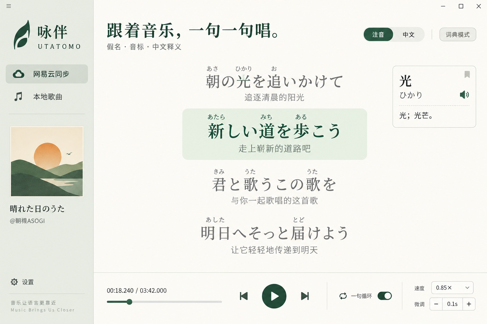

# 界面设计

名称：**咏伴 · Utatomo**。图标将叶片与上扬的音符轮廓组合，表达陪伴练唱；署名为 **@朝禊ASOGI**，点击打开作者 B 站空间。

## 设计稿与实现

在编写前端前，使用 **内置 imagegen 工具**生成了 `assets/design-mockup.png`。前端以此为依据实现，未使用 CLI 或外部 API 生图。

设计稿：



- 米白 `#faf9f5` 为阅读背景，浅灰绿 `#eeefe7` 为侧栏，蓝色 `#315ec5` 标识主要操作和当前行。
- 左侧只保留来源、当前曲目信息、打开音频及作者信息。
- 原文默认使用统一黑体优先栈、常规 400 字重，可在设置里选择本机字体；假名为正文的 52%、英语 IPA 为 48%，深色、中等字重，当前行注音进一步加深。中文译文位于独立一行。
- 当前行采用浅蓝背景和左侧蓝色标记；已唱字词为琥珀色 `#a44708`，未唱正文深灰，历史行中灰。歌词行不显示序号或「第几句」文字。
- 歌曲版本、歌词时间轴、20–64 px 字号、自动跟随开关和模式常驻主界面。词典按需展开；导入、补译与偏移放在次级工具面板。
- 自动跟随默认开启，提供「向下跟随」与「当前句居中」；手动浏览默认持续停留，设置中可开启 4 秒自动返回。居中模式首尾留出足够空间。
- 底部固定毫秒进度条和练唱操作，不随歌词滚动。
- 键盘焦点可见；布局针对 960 × 700 及更大窗口适配；尊重减少动画偏好。

最初设计稿保留作历史参考；当前实现以本节文字规范为准，加入了「连接客户端」和真实同步状态提示。

## 0.4.0：把阅读和管理分开

按 UI/UX Pro Max 的扁平风格、焦点可见、明确空状态、即时搜索与减少布局重绘建议，延续原米白和蓝色，不改成音乐营销页的高饱和配色或引入在线字体。

- 侧栏区分播放来源与「最近播放 / 曲库收藏」入口。打开曲库不改变播放模式；只有点击歌曲播放才切歌。封面下提供「最爱」与「加入歌单」快捷按钮，最爱使用深色实心心形与 aria-pressed 表达。
- 曲库为宽对话框：顶部两个页签，左侧固定的「全部曲目」「最爱」及本地歌单，右侧来源筛选、搜索与歌曲列表。行内播放、收藏、加歌单、移除各司其职；不是每首歌套卡片。每页 50 首，固定操作区与单一列表滚动，在 960×700 保持可用。
- 本地和云端来源使用文字标签，当前曲目有侧边线与浅底色。文件缺失时名称仍清晰可读，提供重新定位；空列表和无搜索结果各给出下一步。
- 桌面按钮以 34–36px 可操作高度和可见焦点为主，次要图标至少 32px；选中、悬停、按下和禁用状态清晰。不用位移表现按压，避免操作目标跳动。
- 设置保留分组与可滚动空间，提高正文和辅助信息对比度；显示开关可自然换行，不以缩小字号强塞。小窗口先缩小装饰封面及留白，保留操作入口。
- 弹窗使用静态遮罩，不用背景模糊；打开时暂停背后的歌词动画和高频控件绘制，播放与状态同步继续运行。关闭时回到实际进度。注音修正保存局部更新，不闪空整页。
- 错误紧邻输入，保存中禁用重复操作，成功回执后才关闭；取消与 Esc 不删除曲目。删除文字准确区分记录、歌单关系和音频文件。

### 0.4.0 试用后的同版本修订

- 红心只表达「最爱」，导入曲库和加入歌单不自动点亮红心。取消最爱不移出曲库或歌单；全局移除只在「全部曲目」提供深红垃圾桶与明确确认，最爱页不出现重复的移除按钮。
- 选择字体只更新 CSS 变量，不重建歌词行；原文和预览同步生效，注音单独保持易读字体。已卸载字体有明确提示与默认恢复。默认字体栈优先覆盖简繁中文/假名/拉丁字形，当前与非当前行保持 400 字重。
- 网易云列表切歌不再走会激活窗口的启动协议；已有直连通道直接处理播放。普通 SMTC 模式提供「连接客户端以后台切歌」，不在失败后抢回焦点或偷偷隐藏客户端。

## 实际使用的生图提示词

```text
Use case: ui-mockup. Design a polished Windows desktop Japanese and English song learning application named 咏伴 UTATOMO. Wide 1536x1024 front-on app screenshot, no device frame. Warm ivory canvas, deep forest green accent, restrained orange current lyric progress, precise typography. Slim left sidebar 220px with abstract musical leaf monogram, app title 咏伴, navigation 网易云同步 and 本地歌曲, an elegant minimal album art square (abstract sun over rolling green hills), song metadata 晴れた日のうた, small author @朝禊ASOGI. Main large panel with top heading 跟着音乐，一句一句唱。, subtitle 假名 · 音标 · 中文释义, small toggles 注音 中文 词典模式. Middle roomy 4 lines of Japanese lyrics using original sample text: 朝の光を追いかけて / 新しい道を歩こう / 君と歌うこの歌を / 明日へそっと届けよう. Tiny hiragana ruby above kanji and smaller Chinese translation below each line. Current line in forest green with pale green rounded highlight, previous and next lines muted. Right small compact dictionary card 光 ひかり 光；光芒. Bottom player panel timestamp 00:18.240 / 03:42.000, thin fine seeking slider with green thumb, previous play next buttons, single line repeat 一句循环, speed 0.85×, fine adjustment ±0.1s. Lots of whitespace, simple beautiful professional desktop utility, subtle borders, no gradients on main UI, realistic implementable frontend design.
```
